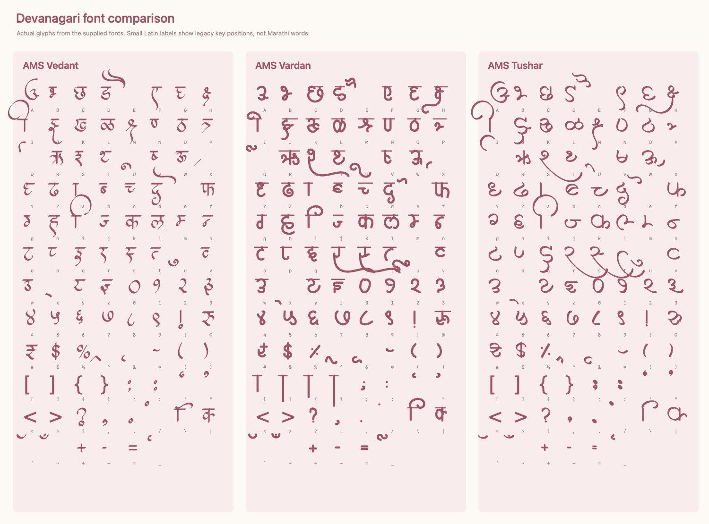

# Marathi font review

**Selected font: AMS Tushar**, as requested. It is used for Marathi names, initials, ceremony titles, and the celebrations heading. Mukta remains the body, navigation, and form font.

The English design uses Great Vibes for names, Tangerine for expressive headings, and Montserrat for practical text. The Marathi version should preserve that distinction between decorative and functional typography.

| Supplied font | Visual character | Fit with the invitation |
| --- | --- | --- |
| AMS Vedant | Fine, formal calligraphy with tapered strokes and graceful flourishes | Closest match for the couple’s names and expressive headings |
| AMS Vardan | Heavier, rounder, and more upright | Stronger than the delicate English display typography |
| AMS Tushar | Loose curves and generous loops | More playful and informal than the existing design |

## Compatibility

Inspection of the supplied TTF character maps found no mappings in the Devanagari Unicode range, U+0900–U+097F, in any of the three fonts. They contain Devanagari-shaped glyphs at legacy Latin key positions. Applying them directly to the app’s Unicode Marathi strings would cause font fallback rather than display the intended lettering.

The integration uses verified legacy strings to extract the actual AMS Tushar outlines as a shared SVG sprite. The initial **अ** is customized to the supplied reference: a smaller upper curl, broad lower loop, and complete right-hand stem. This form is applied to the name, seal initial, and both monograms. Its vector source is `scripts/ams-tushar-initial-a.json`; the supplied TTF remains unchanged.

These assets render locally, scale with the layout, and inherit the invitation’s colors. Unicode source text remains in the document for accessibility and copying; no legacy-encoded text is sent to guests or stored in RSVP responses. English typography is unchanged.

The lettering source is `scripts/ams-tushar-text.json`. To regenerate on macOS with the supplied TTF:

```sh
swift -module-cache-path /tmp/wedding-font-module-cache scripts/generate-ams-tushar.swift --proof
```

The generated sprite and dimensions are tracked in `public/calligraphy/ams-tushar.svg` and `src/lib/ams-tushar-metrics.json`. Regular Next.js builds require neither Swift nor a runtime font converter. New or unrecognized text renders in the Unicode body font until a verified lettering asset is added.

[View the selected lettering proof](ams-tushar-proof.png).

## Rendered comparison

The image below renders the actual supplied fonts. Small Latin labels identify legacy key positions; the samples are glyph charts, not Marathi words.


